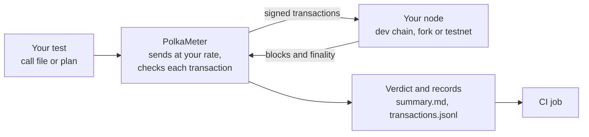

# PolkaMeter

PolkaMeter load-tests Polkadot SDK chains. It sends signed transactions to your node at a set rate, follows each one to the finalized chain and says whether the chain kept up.

## When to use it

- A pull request changes a runtime, a pallet or the node. Run a short load test in CI on every pull request.
- Before a runtime upgrade or a launch. Raise the rate step by step to find where the chain stops keeping up.
- You need evidence, not a guess. Each transaction gets one outcome, checked against the finalized chain, and counts as lost only with proof.

Not for:

- pallet weights: use FRAME benchmarking;
- watching a live network: PolkaMeter loads a node, it doesn't monitor one;
- nodes you don't run: load only a node you control.

## Why not a script?

A script that sends transactions is quick to write. A correct one is not. It must sign against a finalized block, keep each account's nonces in order, send the same bytes again after a dropped connection, and prove a transaction lost before it counts it. Miss one and the test blames the chain for the script's mistake.

PolkaMeter does that part, so your test says only what to send. On nine real chains, a test with PolkaMeter had a median of 43 lines, against 309 for a plain polkadot-api script that did the same job. Both were correct in audited reruns. [Less code, same correctness](less-code.md) has the numbers for each chain.

## Two ways to write a test

| | [Calls mode](calls-mode.md) | [Plan](plans.md) |
| --- | --- | --- |
| You write | a polkadot-api call file | an XML plan |
| It sends | your own calls, at one rate | remarks, transfers or a plugin's transactions, at rising rates |
| It answers | Did the chain keep up at this rate? | At what rate did the chain stop keeping up? |
| Verdicts | PASS, FAIL, CANNOT TELL | PASS, WARN, FAIL, INCONCLUSIVE |

New here? [Install](install.md) and start the [dev chain](getting-started.md#2-start-a-dev-chain). To test your own calls at one rate, go to [Calls mode](calls-mode.md). To find the rate where the chain stops keeping up, follow [Getting started](getting-started.md). Then [run it in CI](ci.md).
