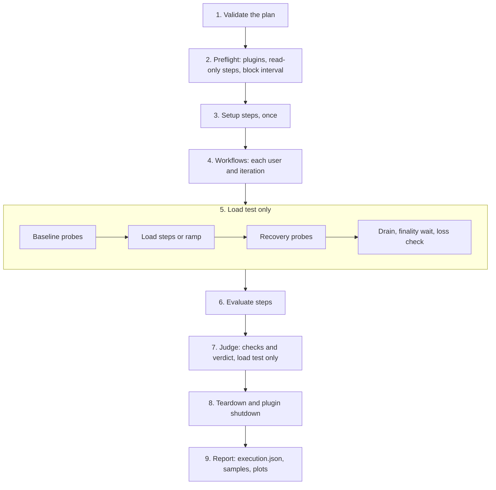

# How a run works

A run takes a plan and leaves a run directory with an outcome and, for a load test, a verdict. The files are described in [Run directory](results.md).

## The phases of a run

The phases run in this order. A plan without a load test skips phase 5, and the judgement in phase 7.

1. **Validate.** PolkaMeter checks the plan's structure and references without contacting a chain or starting a plugin. A plan that fails here leaves no run directory.
2. **Preflight.** It checks the installed plugins against the plan, runs the preflight steps and, for a load test, compares the block interval with the chain's. Preflight steps cannot change chain state.
3. **Setup.** Setup steps run once. They usually prepare the transactions the load sends.
4. **Workflows.** Each workflow runs its users and their iterations.
5. **Load test.** The baseline sends one probe per block with no load. The load sends transactions at the plan's rate steps or ramp until a stop rule ends it. Recovery probes once per block until the chain is back or `recovery-seconds` runs out. Then the run waits for finality and checks every transaction.
6. **Evaluate.** Evaluate steps run, and plugins can return checks from them.
7. **Judge.** The built-in checks run on the recorded data, and the verdict follows.
8. **Teardown.** Teardown steps run even after a failure in setup or later, and then the plugins shut down. A run that fails in preflight submitted nothing, so it skips teardown and exits `3`.
9. **Report.** The run writes its outcome, `samples.jtl` and the plots.

The run as a whole has a deadline, the plan's `timeout-ms`, one hour by default. An error in preflight, setup, a workflow or an evaluate step ends the run as `failed`, with exit code 3 in preflight and 1 after it. A stop rule that fires during the load is a result, not an error, so the report is still written.

## Plan validation

The [plan schema](https://github.com/agustinustheo/polkameter/blob/main/schemas/polkameter-plan.xsd) gives XML editors checks without running PolkaMeter. It checks required attributes, value limits and identifiers. It also checks operation syntax, unique IDs and target references, and supplies the same attribute defaults as the CLI.

The schema uses XML Schema Definition version 1.0 (XSD 1.0), which cannot express every plan rule. Run `polkameter validate` as well; it checks the plan without starting a plugin or contacting a chain. The [plan reference](plans.md#validation-rules) lists the requirements.

### Why some checks need the CLI

XSD 1.0 can choose between child elements, but cannot require exactly one of two attributes or make one attribute depend on another. The CLI therefore checks that an input has exactly one of `ref` or `value`, and a ramp exactly one of `step` or `growth`. It also checks that load `state-check` and `state-ref` appear together.

Plan sections can appear in any order, and workflows can repeat. XSD 1.0's unordered group, `xs:all`, cannot repeat a workflow, so the schema instead allows a repeated choice of sections. That also allows duplicate singleton sections through the schema; the CLI rejects them.

A schema can check each ramp attribute, but cannot calculate every generated rate. The CLI expands the ramp and rejects negative or non-finite rates. It also checks reference availability in each phase and scope, declared operation providers, and that monitors have a load to watch.

Some limits depend on the parser or the host. The schema uses the 64-bit unsigned limit for native-size counters, while the CLI checks the host's limit.

The CLI limits file size and nesting depth. It accepts comments without `--` and a leading XML declaration for XML 1.x in UTF-8, and rejects other declarations, processing instructions and characters that XML 1.0 does not allow.

The CLI requires a default namespace with unprefixed element names. The schema checks namespace identity instead, so it can accept prefixed names that the CLI rejects.

### Why parachain ID zero is accepted

Zero is accepted because the SDK's [`ParaId` is an unsigned 32-bit integer](https://docs.rs/polkadot-parachain-primitives/22.0.0/src/polkadot_parachain_primitives/primitives.rs.html). Its system range includes 0 through 1999; the public range starts at 2000. Plan validation checks this numeric range without contacting the relay chain, so it cannot tell whether an ID is registered there.

### Keeping the schema and CLI aligned

CI runs `tests/validate-plans.py` against every example plan and every complete documentation plan. Each case runs both xmllint and `polkameter validate`, with boundary cases for agreement and the intentional gaps above. Rejection cases pin the diagnostic so an unrelated error cannot hide a missed rule.

## Why every transaction gets one status

After the load, PolkaMeter checks each transaction against two sources: the finalized chain and the node's ready pool. The first status that holds wins, in this order: `finalized`, `in_pool`, `refused`, `lost`, `unverified` and `unknown`.

So the counts add up to the number of transactions sent. A transaction is `lost` only when both sources were read and neither holds it. Without the walk of the finalized chain, a transaction that a reorg moved would look lost. Anything the run could not check becomes `unknown` or `unverified`, so a failed read cannot create a loss.

A dispatch failure counts only if it holds on the finalized chain. A transaction can fail in a best block that a reorg then drops, and succeed in the block that replaces it. Once the finalized chain is walked, its block decides. A failure only in a dropped block is counted apart, as `failedOnlyOnFork`. Before finality is verified, the best block is the only evidence, so its failure counts.

A configured state check is part of the loss check. It reads a sample of the transactions that the finalized chain holds and that did not fail there, so a transaction that failed only on a fork is checked too. If the check errors or times out, PolkaMeter has no proof that the included transactions left their state. The "no silent loss" check is then `no result`, and the verdict cannot be PASS.

## Which step a number belongs to

Steps are short, and a slow chain moves work across their edges. PolkaMeter attributes each number to the time it describes:

- A transaction's inclusion and latency belong to the step that sent it, even if it lands later. That is the step whose rate caused it.
- `included/s` of a step is its own transactions that a block included, over the step's length. The backlog of the step before does not count, so `maxSustained` is not inflated by it.
- A block belongs to the step in which it arrived. Its own numbers, such as transactions per block and weight, stay with it.
- A block gap belongs to the time it spans. A gap that crosses a step edge counts in each step for the part inside it. A gap still open when a step ends counts in that step up to its end.

The mean block gap of a step is the step's observed length over the new best blocks that arrived in it. A step in which no new block arrived counts its whole observed length as one gap. The slow blocks rule reads it when the step ends. So a stall late in a step shows in that step, not in the next one.

## Why a dropped connection is not a chain failure

PolkaMeter reaches the node over WebSocket connections: one for the block follower and several for sending. A proxy, a load balancer or an idle timeout can close one while the node is healthy. PolkaMeter opens it again with backoff: it waits 0.25, 0.5, 1, 2, 4 and 8 s between attempts. Each attempt has 5 s to connect, finish the handshake and subscribe. The whole recovery has 15 s.

The block follower counts as back only once its subscriptions work. While it is away, nothing is observed, and that time is left out of the stall and finality stall rules. Every other second since the last new block still counts, across any number of reconnects. So a stall cannot hide behind reconnects, and a reconnect cannot cause one. The first block after a reconnect has no gap. The blocks missed meanwhile are read below the next best block, as after a reorg. The lost time is listed under problems.

If blocks went unobserved for longer than the stall limit in all, a stall could have hidden in that time. The "monitors recorded everything" check is then `no result`, and the verdict cannot be PASS.

When a sending connection drops, the submissions it had written and not seen answered are sent again, first, on the new connection. The node may never have read them, and a later nonce would wait behind a missing one. If the node had read one, it answers "already imported" or "temporarily banned"; PolkaMeter counts that as accepted. Submissions not yet written go out after them. While the connection is down, the other connections carry the load, and its submissions do not count as waiting on the node.

The node is `node down` in three cases:

- It stays unreachable for the 15 s of attempts.
- A connection drops more than 5 times in 60 s.
- A local node that PolkaMeter samples gets a new process ID on its port. A restart drops the pool, so it counts as a failure even when it takes less than 15 s.

If the block follower reconnects and the node has a new peer ID or a new sync starting block, the run goes on. Behind a load balancer, a reconnect can reach another node that is healthy, so this alone does not show that the node failed. PolkaMeter prints a warning: "reconnected to a different node (load balancer, or the node restarted)". It lists it under warnings in `summary.md` and `summary.json`, and as a `warning` event. A warning does not change the verdict or the exit code.

A chain that is really down still stops the load. If no node behind the URL produces new blocks, the stall rule stops it, whichever node answers (after 30 s by default). If blocks come but none is finalized, the finality stall rule stops it (after 60 s by default).

## Which clock a run uses

Every time in a run comes from a clock that never goes back. PolkaMeter reads the wall clock once, when it starts. After that, time advances with the system's monotonic clock. Step lengths, deadlines, the send rate, latencies and the stall rules all use it. The timestamps in the run's files are that start time plus the elapsed monotonic time.

So a wall clock step from NTP or a VM resume does not end a step early, stretch it or cause a burst of sends. If the machine is suspended, the monotonic clock stops. PolkaMeter also reads a clock that keeps counting during a suspend and ignores wall-clock steps: `CLOCK_BOOTTIME` on Linux, `CLOCK_MONOTONIC` on macOS. If that clock moved more than 5 s further than the monotonic one between two send ticks, the load stops on generator limit, because the numbers after a suspend are not the chain's. A wall-clock step never stops the load. On other systems only a send tick more than 5 s late shows a pause.

## Node CPU and memory

PolkaMeter can only sample a node that runs on the same machine. It samples the process in `POLKAMETER_NODE_PID`, or the process listening on the RPC port of a loopback URL (`localhost`, `127.0.0.1` or `::1`).

A port forwarder on that port is not the node, so PolkaMeter does not sample it. That covers an SSH tunnel, `kubectl port-forward`, `socat` and Docker's port proxy. For a remote URL, nothing is sampled. In both cases the run prints why and goes on, and `node.jsonl` stays empty.

If the sampled process ends during the run, the node probably restarted. PolkaMeter looks for the node process now on the port, records the restart under problems and samples the new process. A restart during the load stops it on node down. A restart during recovery ends recovery, which then reports node down. The CPU of the first sample after a restart is not known. With `POLKAMETER_NODE_PID` and a URL that is not loopback, a restarted node cannot be found again.

## Why stress mode exits 0 by default

A stress run measures where the chain stops keeping up, and finding that point is its job. By default, the exit code reports whether PolkaMeter finished without an error of its own. A breaking point, a `FAIL` verdict or a failed check goes into `summary.json` and `summary.md` without changing the default exit code.

Smoke mode ends the load at the first monitor problem, and it exits `1` on a monitor problem or on a required check with no result. To also exit `1` on a `FAIL` verdict in either mode, use `polkameter run --fail-on-verdict`; for an `INCONCLUSIVE` verdict, use `--fail-on-inconclusive`. The [GitHub Action](ci.md#what-fails-the-job) fails the job on both by default.

## For contributors

### The crates

PolkaMeter is a Cargo workspace with two published crates. The CLI and the remote agent are one binary, `polkameter`, and the engine inside that crate does the work. Plugins depend only on the SDK.

| Crate | Path | What it owns |
| --- | --- | --- |
| `polkameter` | `crates/cli` | The `polkameter` binary: the commands, the plugin registry commands, the remote agent (`remote.rs`), and the agent's run lifecycle (`plugin_application.rs`). It also holds the engine and the load runner, described below. |
| `polkameter-plugin-sdk` | `crates/plugin-sdk` | The JSON-line protocol between the host and a plugin, and the `Plugin` trait that a plugin implements. With the `chain` feature, one node over RPC. With the `observers` feature, the run directory's format, the block walker and the checks. |
| `polkameter-example-plugin` | `plugins/example` | An example plugin. It doubles numbers and waits, and it prepares no transactions. Not published. |

Inside `polkameter`:

| Module | Path | What it owns |
| --- | --- | --- |
| `engine` | `crates/cli/src/engine` | Plan parsing (`plan.rs`, `xml.rs`), the plugin registry and host (`plugins.rs`), the phases (`execute.rs`), measurement wiring (`measurement.rs`, `wiring.rs`), and `samples.jtl` and the plots (`artifacts.rs`, `plots.rs`). |
| `engine::monitors` | `crates/cli/src/engine/monitors` | Monitors that each write one raw file: the metric scraper, the relay recorder, the process sampler, the topology reader and preflight. |
| `load` | `crates/cli/src/load` | The load test runner: transaction sources, the sender, the tracker, the block follower, the rate steps, the stop rules, recovery and the loss check. |

Inside `polkameter-plugin-sdk`:

| Module | Feature | Path | What it owns |
| --- | --- | --- | --- |
| crate root | default | `crates/plugin-sdk/src/lib.rs` | The protocol. |
| `chain` | `chain` | `crates/plugin-sdk/src/chain` | One node over RPC: typed reads and events with subxt, and JSON-RPC calls. |
| `observers::files` | `observers` | `crates/plugin-sdk/src/observers/files` | The run directory's format: the file writers, the metric registry, the `summary.json` types, the record types and the reader that merges the files. |
| `observers::monitors` | `observers` | `crates/plugin-sdk/src/observers/monitors` | The block walker and the series writer that chain recorders, built-in or in a plugin, run under. |
| `observers::checks` | `observers` | `crates/plugin-sdk/src/observers/checks` | The evaluator. It reads a finished run's files, runs the outcome checks and writes `summary.json` and `summary.md`. |

Dependencies point one way. `polkameter-plugin-sdk` depends on no other PolkaMeter crate, and `polkameter` depends on the SDK with every feature on. The engine and the load runner are public modules of `polkameter` only so the tests can use them; they are not a library API.

### How a run flows through the crates

1. `engine::execute::run` validates the plan, creates the run directory and opens `events.jsonl`. Every phase event is written there.
2. `engine::plugins` starts one process for each plugin the plan declares. Each step sends an operation over the SDK protocol and gets its outputs back.
3. For a load test, `engine::measurement::run` starts the monitors and connects the load to the node through the SDK's `chain` module. The load runner sends the prepared transactions and writes its own files.
4. After the finality wait, `load::loss` gives each transaction its status.
5. `observers::checks::report::write` reads the files through `observers::files`, runs the checks and writes `summary.json` and `summary.md`.
6. `engine::artifacts` writes `samples.jtl` and the plots, and `execute` writes `execution.json`.

Each part writes its own raw files and does not call the others for data. Only `observers::files` knows the formats. That is why `polkameter report` can run steps 5 and 6 again from the files alone.

### Testing

The load tracker is plain code that is tested without a network, and the checks run on any finished run's files. `tests/cli-smoke.sh` runs the CLI end to end without a chain.

### Where to change things

- A new check: add its metric to the registry in `crates/plugin-sdk/src/observers/files/registry.rs`, record it in a monitor if none does, and add the check to one of the lists in `crates/plugin-sdk/src/observers/checks/outcomes/`.
- A stop rule or a default threshold: `crates/cli/src/load/rules.rs` holds every rule of the load in one place.
- A limit that a check compares against: `crates/plugin-sdk/src/observers/checks/limits.rs`.
- The checks to run before a pull request are listed in the Development section of the repository's README.
