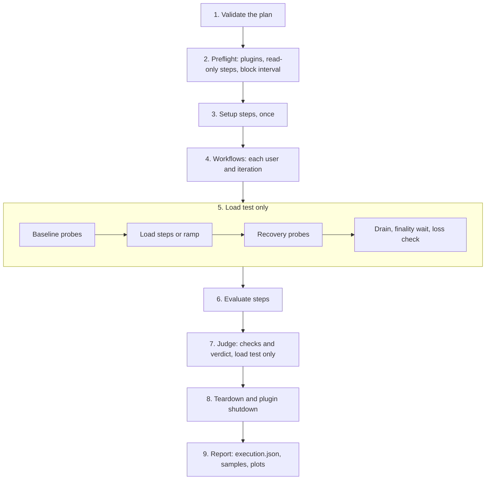

# How a run works

A run takes a plan and leaves a run directory with an outcome and, for a load test, a verdict. The files are described in [Run directory](results.md).

## The phases of a run

The phases run in this order. A plan without a load test skips phase 5, and the judgement in phase 7.

1. **Validate.** PolkaMeter checks the plan's structure and references without contacting a chain or starting a plugin. A plan that fails here leaves no run directory.
2. **Preflight.** It checks the installed plugins against the plan, runs the preflight steps and, for a load test, compares the block interval with the chain's. Preflight steps cannot change chain state.
3. **Setup.** Setup steps run once. They usually prepare the transactions the load sends.
4. **Workflows.** Each workflow runs its users and their iterations.
5. **Load test.** The baseline sends one probe per block with no load. The load sends transactions at the plan's rate steps or ramp until a stop rule ends it. Recovery probes once per block until the chain is back or `recovery-seconds` runs out. Then the run waits for finality and checks every transaction.
6. **Evaluate.** Evaluate steps run, and plugins can return checks from them.
7. **Judge.** The built-in checks run on the recorded data, and the verdict follows.
8. **Teardown.** Teardown steps run even after a failure, and then the plugins shut down.
9. **Report.** The run writes its outcome, `samples.jtl` and the plots.

The run as a whole has a deadline, the plan's `timeout-ms`, one hour by default. An error in preflight, setup, a workflow or an evaluate step ends the run as `failed`. A stop rule that fires during the load is a result, not an error, so the report is still written.

## Why every transaction gets one status

After the load, PolkaMeter checks each transaction against two sources: the finalized chain and the node's ready pool. The first status that holds wins, in this order: `finalized`, `in_pool`, `refused`, `lost`, `unverified` and `unknown`.

So the counts add up to the number of transactions sent. A transaction is `lost` only when both sources were read and neither holds it. Without the walk of the finalized chain, a transaction that a reorg moved would look lost. Anything the run could not check becomes `unknown` or `unverified`, so a failed read cannot create a loss.

## Why stress mode exits 0 by default

A stress run measures where the chain stops keeping up, and finding that point is its job. By default, the exit code reports whether PolkaMeter finished without an error of its own. A breaking point, a `FAIL` verdict or a failed check goes into `summary.json` and `summary.md` without changing the default exit code.

Smoke mode ends the load at the first monitor problem, and it exits `1` on a monitor problem or on a required check with no result. To also exit `1` on a `FAIL` verdict in either mode, use `polkameter run --fail-on-verdict`, or set `fail-on: verdict` on the [GitHub Action](ci.md#what-fails-the-job).

## For contributors

### The crates

PolkaMeter is a Cargo workspace. The CLI and the remote agent are one binary, `polkameter`, and the engine under it does the work.

| Crate | Path | What it owns |
| --- | --- | --- |
| `polkameter` | `crates/cli` | The `polkameter` binary: the commands, the plugin registry commands, the remote agent (`remote.rs`), and the agent's run lifecycle (`plugin_application.rs`). |
| `polkameter-engine` | `crates/engine` | Plan parsing (`plan.rs`, `xml.rs`), the plugin registry and host (`plugins.rs`), the phases (`execute.rs`), measurement wiring (`measurement.rs`, `wiring.rs`), and `samples.jtl` and the plots (`artifacts.rs`, `plots.rs`). |
| `polkameter-load` | `crates/load` | The load test runner: transaction sources, the sender, the tracker, the block follower, the rate steps, the stop rules, recovery and the loss check. |
| `polkameter-chain` | `crates/chain` | One node over RPC: typed reads and events with subxt, and JSON-RPC calls. |
| `polkameter-monitors` | `crates/monitors` | Monitors that each write one raw file: the metric scraper, the relay recorder, the process sampler, the topology reader, preflight and the block walker. |
| `polkameter-files` | `crates/files` | The run directory's format: the file writers, the metric registry, the `summary.json` types, the record types and the reader that merges the files. |
| `polkameter-checks` | `crates/checks` | The evaluator. It reads a finished run's files, runs the outcome checks and writes `summary.json` and `summary.md`. |
| `polkameter-plugin-sdk` | `crates/plugin-sdk` | The JSON-line protocol between the host and a plugin, and the `Plugin` trait that a plugin implements. |
| `polkameter-example-plugin` | `plugins/example` | An example plugin. It doubles numbers and waits, and it prepares no transactions. |

Dependencies point one way. `polkameter-files`, `polkameter-chain` and `polkameter-plugin-sdk` depend on no other PolkaMeter crate. `polkameter-checks` depends only on `polkameter-files`. `polkameter-load` and `polkameter-monitors` depend on `files` and `chain`. `polkameter-engine` depends on all of them, and `polkameter` depends only on the engine.

### How a run flows through the crates

1. `engine::execute::run` validates the plan, creates the run directory and opens `events.jsonl`. Every phase event is written there.
2. `engine::plugins` starts one process for each plugin the plan declares. Each step sends an operation over the `plugin-sdk` protocol and gets its outputs back.
3. For a load test, `engine::measurement::run` starts the monitors and connects the load to the node through `polkameter-chain`. The load runner sends the prepared transactions and writes its own files.
4. After the finality wait, `load::loss` gives each transaction its status.
5. `checks::report::write` reads the files through `polkameter-files`, runs the checks and writes `summary.json` and `summary.md`.
6. `engine::artifacts` writes `samples.jtl` and the plots, and `execute` writes `execution.json`.

Each crate writes its own raw files and does not call the others for data. Only `polkameter-files` knows the formats. That is why `polkameter report` can run steps 5 and 6 again from the files alone.

### Testing

The load tracker is plain code that is tested without a network, and the checks run on any finished run's files. `tests/cli-smoke.sh` runs the CLI end to end without a chain.

### Where to change things

- A new check: add its metric to the registry in `crates/files`, record it in a monitor if none does, and add the check to one of the lists in `crates/checks/src/outcomes/`.
- A stop rule or a default threshold: `crates/load/src/rules.rs` holds every rule of the load in one place.
- A limit that a check compares against: `crates/checks/src/limits.rs`.
- The checks to run before a pull request are listed in the Development section of the repository's README.
