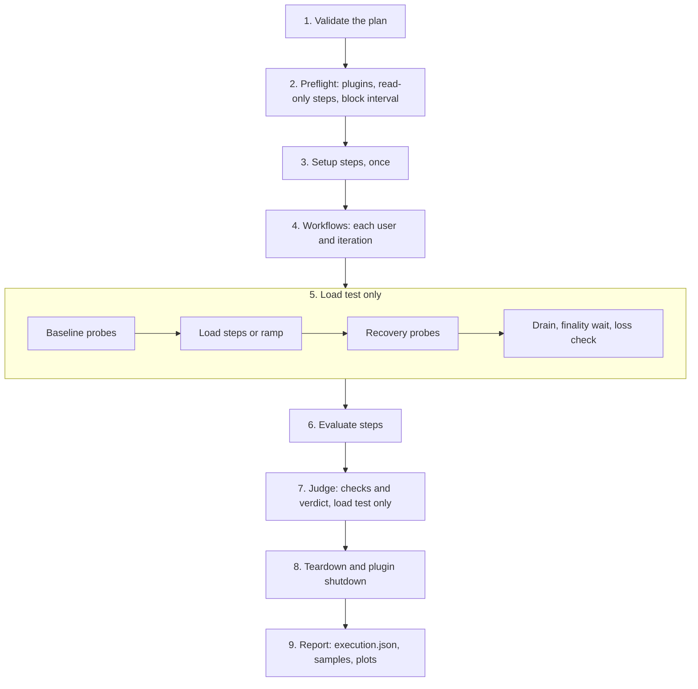

# How a run works

PolkaMeter runs your plan and records how it ended. A load test also gives a verdict. [Run directory](results.md) describes the files it writes.

## The phases of a run

The phases run in this order. A plan without a load test skips phase 5 and the verdict in phase 7.

1. Validate. PolkaMeter checks the plan's structure and references. It doesn't contact a chain or start a plugin. A plan that fails here leaves no run directory.
2. Preflight. It checks the installed plugins against the plan and runs the preflight steps. For a load test, it also compares the block interval with the chain's. Preflight steps can't change chain state.
3. Setup. Setup steps run once. They usually prepare the transactions for the load.
4. Workflows. Each workflow runs its users and their iterations.
5. Load test. The baseline sends one probe per block with no load. Then the flood runs through the plan's rate steps or ramp until every step ran or a stop rule ends it. Recovery sends one probe per block until the chain is back or `recovery-seconds` runs out. Then the run waits for finality and checks every flood transaction.
6. Evaluate. Evaluate steps run, and plugins can return checks from them.
7. Judge. The built-in checks run on the recorded data, and the verdict follows.
8. Teardown. Teardown steps run even after a failure in setup or later. Then the plugins shut down. A run that fails in preflight sent nothing, so it skips teardown.
9. Report. The run writes its outcome, `samples.jtl` and the plots.

An error in preflight, setup, a workflow or an evaluate step ends the run as `failed`. A stop rule that fires during the load is a result, not an error, so the report is still written. [Exit codes](cli.md#exit-codes) lists what each case returns.

## Why every transaction gets one status

After the load, PolkaMeter checks each flood transaction against two sources: the finalized chain and the node's ready pool. Each one gets exactly one status, so the counts add up to the number sent. Funding transactions and probes aren't part of it. [Loss accounting](results.md#loss-accounting) lists the statuses.

A loss count is only useful if you can trust it, so `lost` needs evidence from both sources. Without reading the finalized chain, a transaction that a reorg moved to another block would look lost. So anything PolkaMeter couldn't check becomes `unknown` or `unverified`. A failed read never creates a loss.

The same goes for dispatch failures. A transaction can fail in a best block that a reorg then drops, and succeed in the block that replaces it. Once PolkaMeter reads the finalized chain, the finalized block decides. Before finality is verified, the best block is the only evidence, so its failure counts.

A state check is part of the loss check. It reads a sample of the transactions that the finalized chain holds and that didn't fail there. If it gives no result, PolkaMeter has no proof that those transactions changed state. [Loss accounting](results.md#loss-accounting) gives the effect on the verdict.

## Why a dropped connection is not a chain failure

PolkaMeter talks to the node over WebSocket connections: one to follow blocks and several to send. A connection can close while the node still works, for example behind a proxy or a load balancer. PolkaMeter tries to reconnect, for up to 15 s.

While the block follower is away, PolkaMeter can't see blocks. That time is left out of the stall and finality stall rules, and it's listed under problems. Every other second since the last new block still counts. So a stall can't hide behind reconnects, and a reconnect can't cause one. If blocks went unseen for longer than the stall limit in total, the "monitors recorded everything" check has no result, and the verdict can't be PASS.

After a sending connection drops, PolkaMeter can resend a transaction whose reply is missing. The node may never have read it. Loss accounting still counts it once.

The node counts as down when it stays unreachable for 15 s, when a connection drops more than 5 times in 60 s, or when a local node's process restarts. A restart drops the pool, so it counts even when it's quick.

A chain that's really down still stops the load. If no new blocks arrive, the stall rule stops it after 30 s by default. If blocks arrive but none is finalized, the finality stall rule stops it after 60 s by default.

If the machine is suspended for more than 5 s, the load stops on generator limit.

## Node CPU and memory

PolkaMeter can only sample a node that runs on the same machine. It samples the process in `POLKAMETER_NODE_PID`, or the process listening on the RPC port of a loopback URL (`localhost`, `127.0.0.1` or `::1`).

Without `POLKAMETER_NODE_PID`, PolkaMeter samples neither a port forwarder nor a process behind a non-loopback URL. It explains why and continues with an empty `node.jsonl`.

If the sampled process ends during the run, the node probably restarted. PolkaMeter finds the new process on the port, records the restart under problems and samples the new process. A restart during the load stops it on node down. With `POLKAMETER_NODE_PID` and a URL that isn't loopback, PolkaMeter can't find a restarted node again.

## Why stress mode exits 0 by default

A stress test is there to find where the chain stops keeping up. Finding that point is the job, not an error. So by default the exit code only says whether PolkaMeter itself finished without an error. A breaking point, a FAIL verdict or a failed check goes into `summary.md` and `summary.json`.

When you want the verdict to fail the command, as in CI, use the flags in [`run`](cli.md#run).
