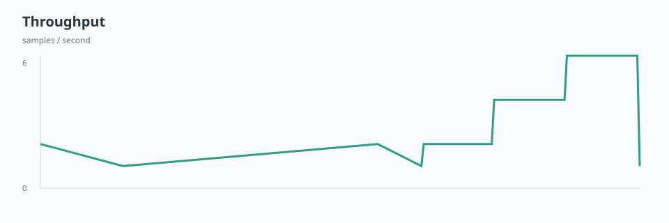
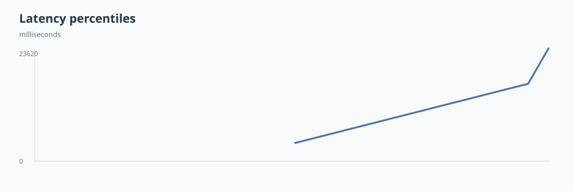

# Read the results

A load run writes its answers to `summary.md` in its run directory. The examples come from a recorded load run in the repository's test fixtures, regenerated with `polkameter report` on a copy. The fixture itself is unchanged.

## Did it pass?

The verdict is on the `- **Verdict:**` line of `summary.md`. The first rule that matches decides it:

- **FAIL:** the load ended on a graceful or hard stop, a failure mode was recorded, a breaking point was found, or a check failed.
- **INCONCLUSIVE:** the load ended on budget used up, generator limit or smoke error, or every step ran but a required check has no result. The chain was not pushed to its limit, so the run tells you little.
- **WARN:** every step ran and some check warned.
- **PASS:** every step ran and no check warned or failed.

The example's verdict and load summary:

```markdown
- **Verdict:** FAIL
- **Failure onset** (first failed load step): step 0 (2 tx/s): latency, p95 send -> best block 23.1 s
- **Max sustained:** none
- **Load stop:** rate cap: all 3 steps ran
```

Three separate things tell you how a run ended:

| Question | Where to look | Example |
| --- | --- | --- |
| Did the chain pass the test? | Verdict in `summary.md` | `FAIL` |
| Why did the load stop? | `Load stop:` in `summary.md`, or `stop` in `summary.json` | `rate cap: all 3 steps ran` |
| Did the run finish without an error? | Exit code, and `state` in `execution.json` | `0`, `completed` |

> **Warning:** Exit code `0` does not mean the test passed. In stress mode, a run with verdict `FAIL` still completes with exit code `0`. Read the verdict. A smoke-mode plan (`mode="smoke"`) also exits `1` on a monitor problem or a required check with no result.

The outcome checks table at the end of `summary.md` gives each check a status: `pass`, `warn`, `fail`, `info` or `no result`. In the example, the relay slots check failed. A failed check makes the verdict FAIL, as a breaking point does.

## How much load did the chain take?

The `Load steps` table has one row per step. It has 17 columns. This copy keeps the main ones:

| step | target tx/s | sent/s | included/s | included % | p95 s (limit 10.0) |
| ---: | ---: | ---: | ---: | ---: | ---: |
| 0 | 2 | 2 | 0 | 100.0 | 23.1 |
| 1 | 4 | 4 | 5 | 100.0 | 6.0 |
| 2 | 6 | 6 | 6 | 100.0 | 6.2 |

Step 0 ran at 2 tx/s, but its p95 was 23.1 s, above the 10 s limit. That makes it the **breaking point**, which the summary calls the failure onset. `Max sustained` is the step before it. Here there is none. [Results](results.md#stop-rules-and-thresholds) defines both fields.

The throughput plot counts samples per second. Its top label is the highest count, 6 here.



The table lists every rule. The three breaking point rules do not stop the load. Graceful and hard stops end the ramp as failures. Other stops end it without one, and the verdict decides what they mean.

| Rule | Meaning |
| --- | --- |
| Breaking point: included | Not a stop. A step includes less than 90% of its transactions |
| Breaking point: latency | Not a stop. The p95 send-to-inclusion time is above 10 s |
| Breaking point: refused | Not a stop. More than 1% of submissions are refused |
| Pool refuses | Graceful. More than 10% of submissions are refused, in this step or the one before |
| Pool intake | Graceful. The node is slow to accept submissions: p95 reply above 5 s, or a submit waited that long |
| Slow blocks | Hard. The mean block gap is more than twice the plan's `block-interval-seconds` |
| Stall | Hard. No new best block for 30 s |
| Finality stall | Hard. No new finalized block for 60 s |
| Node down | Hard. The node closed an RPC connection |
| Rate cap | Every step ran. The ramp finished |
| Budget used up | The prepared transactions ran out |
| Generator limit | The load tool could not send at least 95% of the target rate |
| Smoke error | A monitor problem, in smoke mode only |

[Results](results.md#stop-rules-and-thresholds) lists the default thresholds. The [plan](plans.md#thresholds) can change them.

## How slow did it get?

The p50 and p95 columns give send-to-inclusion time for each step. The breaking point rule checks p95 against its limit. `reply p95 s` is how long the node took to answer a submission. Here it stayed at 0.03 s.

The latency plot shows the 50th, 95th and 99th percentiles of the samples' elapsed time, in milliseconds, from left to right. Its top label, 23620 ms, is the highest point: the 99th percentile.



## Did transactions get lost?

Every sent transaction ends with exactly one status in `transactions.jsonl`:

- `finalized`: included in a finalized block.
- `in_pool`: still ready in the node's pool.
- `refused`: the node refused it.
- `lost`: accepted or seen in a best block, but in no finalized block and not ready in the pool.
- `unverified`: seen in a best block, but finality was not verified.
- `unknown`: not enough evidence to decide.

Only `lost` counts as lost. The loss check line in `summary.md` gives the totals:

```markdown
- **Loss check:** 360 sent: 360 finalized (0 failed after inclusion), 0 refused, 0 still ready in the pool, 0 seen in a block but not verified final, **0 lost**, 0 unknown ...
```

Every load run creates `lost.jsonl`, which lists the first 1000 lost transactions, one per line. An empty file means nothing was lost. Any lost transaction makes the verdict FAIL. [Loss accounting](results.md#loss-accounting) defines each status.

## Did the chain recover?

After the load stops, PolkaMeter sends one probe per block until probes land in time again. A probe is in time when it is included within the recovery threshold: the larger of twice the slowest baseline probe and twice the block interval.

```markdown
- **Baseline:** 3 probes before the load, p50 6.0 s, max 6.0 s
- **Recovery:** back 1 s after the load stopped (3 probes in a row landed within 12.0 s). Backlog at stop 37 txs, drained after 7 s, at 2.1 tx/s.
```

`Backlog at stop` counts transactions still waiting when the load stopped. `drained after` is how long the pool took to empty. The summary lists the recovery probes with their landing times:

```text
Recovery probes (one per block; landing within 12.0 s counts as back):
0 s: 5.6 s, 6 s: 6.0 s, 12 s: 6.0 s, 18 s: pending
```

`pending` means no result yet. If the chain does not recover within `recovery-seconds`, the run gives up. [Recovery](results.md#recovery) lists the matching fields in `summary.json`.
