# Examples: a stress test per chain, with calls mode and without

Each `examples/<chain>/` holds a stress test of one real Polkadot SDK chain, written by an AI agent with PolkaMeter
calls mode (`polkameter calls`). Next to it, `plain-papi/` holds the test another agent wrote for the same task with
plain [polkadot-api](https://papi.how) and no PolkaMeter. Both had to meet the same bar, and independent scorers
checked both on the chain. This is a dated record from November 2026, not maintained examples: live chains upgrade,
so these tests drift. Only `dev-chain/` runs in CI.

<!-- ANCHOR: comparison -->
## The comparison

Lines are every file in the test's folder, counted by `count-lines.py` (code and config; no blank lines, comments,
lockfiles, `package.json` or generated types). CI recounts them and fails if this table is wrong.

```mermaid
---
config:
  themeVariables:
    xyChart:
      plotColorPalette: "#9ca3af, #e6007a"
---
xychart-beta
  title "Lines in each stress test: plain polkadot-api (grey), calls mode 0.5.0 (pink)"
  x-axis [Aventus, EWX, Canggu, Myriad, Acala, Darwinia, Acurast, Mythos, Polimec]
  y-axis "lines" 0 --> 400
  bar [309, 255, 336, 361, 379, 300, 293, 270, 336]
  bar [21, 31, 33, 36, 43, 45, 48, 53, 65]
```



| Chain | Call | plain-papi | calls mode, prototype | calls mode, 0.5.0 |
|---|---|---|---|---|
| [Aventus](https://github.com/agustinustheo/polkameter/tree/main/examples/aventus) | `TokenManager.transfer` | 309 | 103 | 21 |
| [Energy Web X](https://github.com/agustinustheo/polkameter/tree/main/examples/ewx) | `LiquidStaking.stake` | 255 | 29 | 31 |
| [Canggu](https://github.com/agustinustheo/polkameter/tree/main/examples/canggu) | `Payroll.batch_pay` | 336 | 60 | 33 |
| [Myriad](https://github.com/agustinustheo/polkameter/tree/main/examples/myriad) | `Tipping.send_tip` | 361 | 66 | 36 |
| [Acala](https://github.com/agustinustheo/polkameter/tree/main/examples/acala) | `Dex.swap_with_exact_supply` | 379 | 68 | 43 |
| [Darwinia](https://github.com/agustinustheo/polkameter/tree/main/examples/darwinia) | `Assets.transfer_keep_alive` | 300 | 91 | 45 |
| [Acurast](https://github.com/agustinustheo/polkameter/tree/main/examples/acurast) | `Acurast.register` | 293 | 80 | 48 |
| [Mythos](https://github.com/agustinustheo/polkameter/tree/main/examples/mythos) | `Nfts.mint` | 270 | 55 | 53 |
| [Polimec](https://github.com/agustinustheo/polkameter/tree/main/examples/polimec) | `LinearRelease.vested_transfer` | 336 | 109 | 65 |
| **Median** | | **309** | **68** | **43** |
| DeBio | `GeneticData.add_genetic_data` | 330 | 261 | unsupported: old runtime, exit 3 at once |
| Hyperbridge | `HyperFungibleToken.send` | 365 | 118 | excluded: its local copy stops after 3 blocks |

The prototype column is the pre-registered experiment. The 0.5.0 column re-measured calls mode on the release
candidate with fresh agents, the same task and the same scoring; most of the drop is prototype bugs fixed in 0.5.0.
Median time for an agent to finish: 24 min with plain-papi, 18 min with calls mode 0.5.0 (prototype: about 1.5×
plain-papi). Each run's `run.sh` is longer than its call file mostly because it prints a summary.

## How it was checked

- Same task for both: send the chain's call at a fixed rate from test accounts the test funds itself; sign against
  a finalized block; never skip or re-sign a nonce; resend identical bytes; reconcile every transaction against the
  finalized chain; report PASS, FAIL (chain-caused only) or CAN'T TELL.
- A separate scorer reran each test on a fresh chain, once clean and once with a hidden 8–14 s RPC outage, and
  audited every transaction on the chain. Every test in the table was correct in both reruns.
- Chains ran as local Chopsticks copies at 0.25 tx/s (they build a block only when a transaction arrives and
  finalize it at once), except Canggu, which ran its own dev node at 5 tx/s.
- At higher rates, on a Polkadot SDK dev node with 64 accounts: calls mode delivered 100% at 100, 300 and 1000 tx/s
  and an independent audit matched every transaction; it passed at 100 and 300 tx/s. At 1000 tx/s the node's pool
  overflowed and dropped transactions, which calls mode reports as CAN'T TELL.

## What this does not show

- Both agents were told the integrity rules. This measures less code at the same correctness, not correctness for
  someone who doesn't know the rules.
- After an RPC outage, calls mode does not resend the load it missed, so it ends CAN'T TELL where the plain tests
  caught up and passed. An outage longer than its 15 s reconnect budget ends the load early (Aventus, 14 s outage).
- Some tests work around the local copies, not the chains: Darwinia sets asset balances with `dev_setStorage`, and
  Polimec's `keeper.mjs` builds its staking-round blocks empty because Chopsticks drops transactions placed in them.
- All tests were written by one AI model, one test per chain per side, at low rates on local copies of the chains.
- Calls mode can't express transactions authorised by a proof instead of a signature (for example the People chain).
<!-- ANCHOR_END: comparison -->

## Run one

```sh
cd examples/<chain>
../fork.sh <chain> 9944                       # acala, acurast, aventus, darwinia, ewx, mythos
npx --yes --package polkadot-api@3.3.0 papi add <chain> -w ws://127.0.0.1:9944   # the chain's types
./run.sh ws://127.0.0.1:9944 out              # installs the rest; 0 PASS, 1 FAIL, 4 CAN'T TELL, 3 setup failed
```

`run.sh` looks for `polkameter` in `$HOME/.local/bin`, where `install.sh` puts it.
